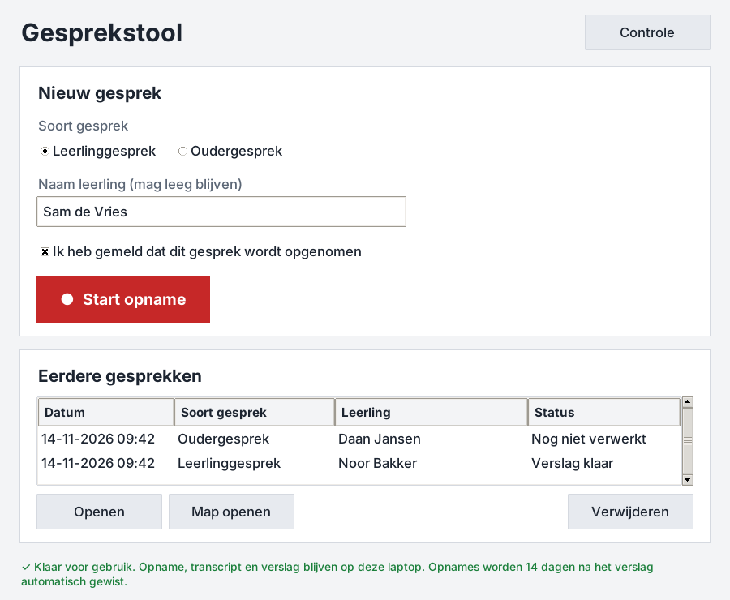
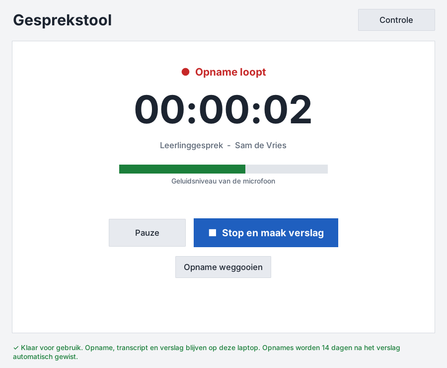
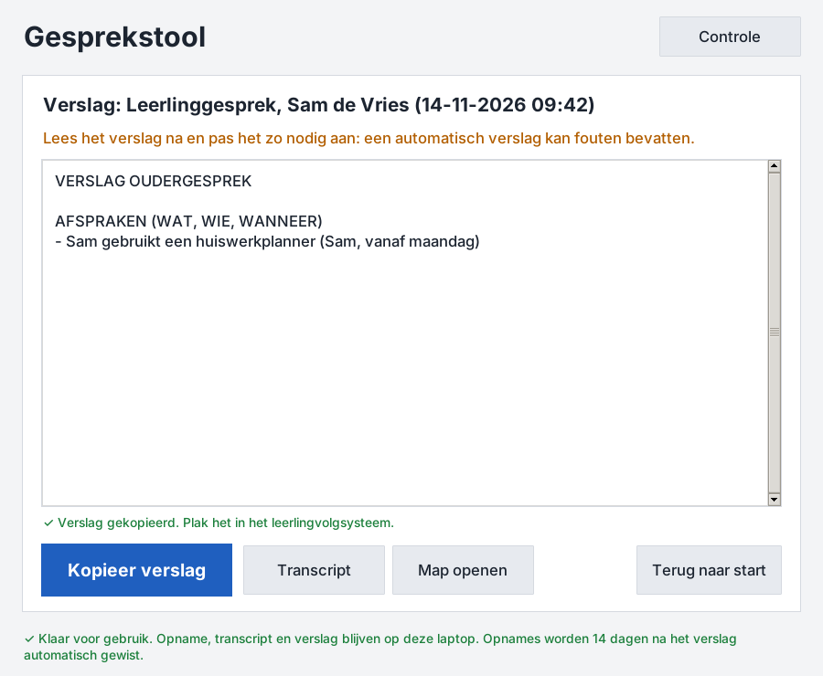

# Gesprekstool

Neemt oudergesprekken en leerlinggesprekken op, schrijft ze uit en maakt een verslag
volgens een vast template. Alles gebeurt op de eigen laptop: er is geen internet nodig
en opname, transcript en verslag verlaten de laptop niet.

- **Instructiefilm (3 minuten):** [docs/instructiefilm.mp4](docs/instructiefilm.mp4), voor
  schoolleiding en docenten. De tekst staat in
  [docs/instructiefilm-script.md](docs/instructiefilm-script.md).
- **Voorbeeld van een echt verslag:** [docs/voorbeeld-echte-test.md](docs/voorbeeld-echte-test.md).
- **Docenten:** lees *Zo werkt het* hieronder.
- **ICT en schoolleiding:** lees [BEHEER.md](BEHEER.md) voor eisen, installatie en advies.

## Zo werkt het



1. Open **Gesprekstool**.
2. Kies het soort gesprek en vul eventueel de naam van de leerling in.
3. Vertel de aanwezigen dat het gesprek wordt opgenomen en vink dat aan.
4. Klik op **Start opname**. Leg de laptop tussen de sprekers in.
5. Klik na het gesprek op **Stop en maak verslag**.
6. Wacht tot het verslag verschijnt. Dat duurt enkele minuten; laat de laptop open staan.
7. Lees het verslag na, verbeter waar nodig en klik op **Kopieer verslag**.
8. Plak het verslag in het leerlingvolgsysteem.



## Goed om te weten

- **De balk onder de tijd** laat zien of de microfoon geluid opvangt. Beweegt hij niet,
  dan komt er geen geluid binnen.
- **Pauze** stopt de opname tijdelijk, bijvoorbeeld als iemand iets vertrouwelijks wil zeggen.
- **Opname weggooien** verwijdert de opname direct en definitief.
- **Gaat er iets mis** bij het maken van het verslag, dan blijft de opname bewaard. Kies het
  gesprek onder *Eerdere gesprekken* en klik op **Openen** om het opnieuw te proberen.
- **Lees het verslag altijd na.** De computer kan woorden verkeerd verstaan en weet niet
  wie wat zei.
- **Opnames worden automatisch gewist** 14 dagen nadat het verslag is gemaakt (de school
  kan deze termijn aanpassen). Transcript en verslag blijven staan tot je ze verwijdert.
- Staat onderaan in rood *Niet klaar voor gebruik*? Klik op **Controle** en geef de
  melding door aan ICT.



## Waar staan de AI-modellen?

De Gesprekstool gebruikt twee modelbestanden: een spraakmodel en een taalmodel. Hij zoekt ze
eerst in de gedeelde map `~/AI-modellen` (Windows: `%USERPROFILE%\AI-modellen`), die ook
andere apps op de laptop kunnen gebruiken:

```
~/AI-modellen/whisper/ggml-large-v3-turbo.bin
~/AI-modellen/llm/gemma-3-12b-it-Q4_K_M.gguf     (of gemma-3-4b-it-Q4_K_M.gguf)
```

Staat een model daar niet, dan gebruikt de tool de kopie van een eerdere installatie
(`/Library/Application Support/Gesprekstool/models`, of op Windows
`C:\ProgramData\Gesprekstool\models`). Andere modellen in de gedeelde map, van andere apps,
laat hij staan.

Welk bestand er gebruikt wordt, zie je bij **Controle**: achter het pad staat *gedeelde map*
of *eigen map*. Het staat ook in `verwerking.log` in de map van elk gesprek. Een andere
gedeelde map stel je in met `gedeelde_modellen_map` (zie [BEHEER.md](BEHEER.md), hoofdstuk 5).

## Voor ontwikkelaars

```bash
# Tests (nagebootste microfoon, spraakherkenning en taalmodel)
xvfb-run -a python3 -m unittest discover -s tests -v      # op macOS/Windows zonder xvfb-run

# Starten vanuit de broncode (vereist: pip install sounddevice, en whisper-cli + llama-server)
python3 start.py              # venster
python3 start.py --controle   # controle op de opdrachtregel
```

| Map | Inhoud |
| --- | --- |
| `gesprekstool/` | de code: `kern.py` (verwerking), `opname.py` (microfoon), `venster.py` (scherm), `cli.py` |
| `templates/` | de verslagtemplates |
| `beheer/` | scripts voor ICT: modellen ophalen en installeren |
| `bouw/` | pakketten bouwen en testen (gebruikt door GitHub Actions) |
| `tests/` | geautomatiseerde tests |
| `docs/film/` | script dat de instructiefilm opnieuw maakt (`maak_film.py`) |
